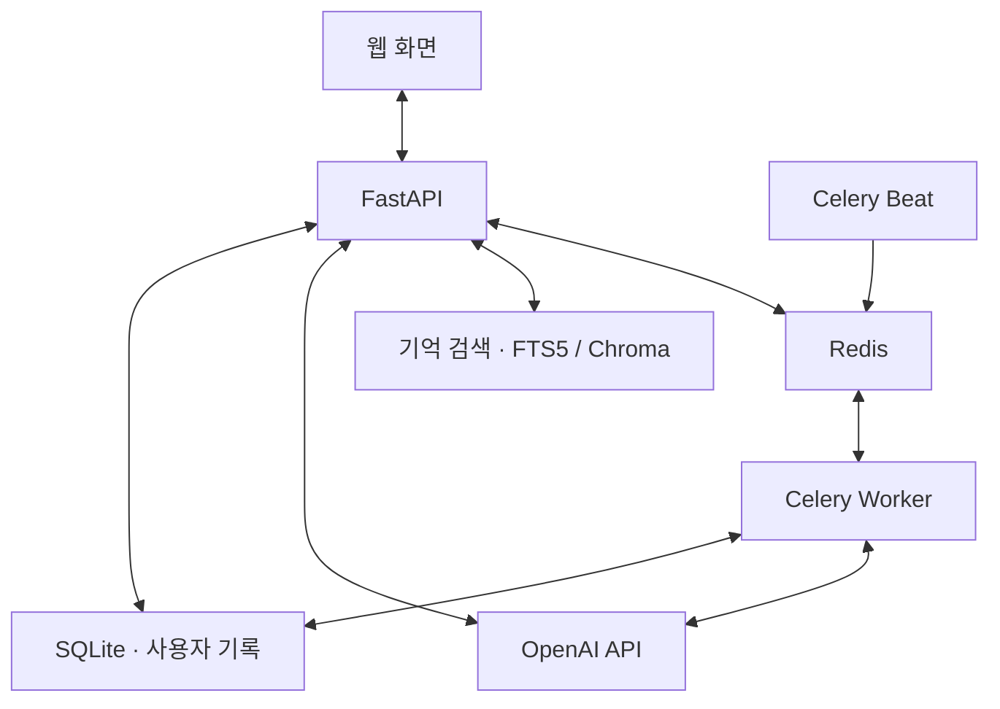

# 나의 이야기가 머무는 공간
### 대화로 하루를 기록하는 AI 다이어리

하루를 잘 정리해서 말하지 않아도 괜찮습니다.  
떠오르는 이야기를 남기고, AI와 대화하며, 나만의 일기로 간직하세요.

**💬 대화하기　·　✍️ 일기 만들기　·　📚 서재　·　💌 응원 편지**

[🌐 웹 서비스 바로가기](https://matabus-pilot-1.taildf2aa2.ts.net/)　|　[✉️ 이용 계정 요청](mailto:gptssy0216@gmail.com)

> 현재 **초대 계정으로만 이용할 수 있습니다.**  
> 이용을 원하시면 **gptssy0216@gmail.com**으로 로그인 계정 발급을 요청해 주세요.

---

## 어떤 서비스인가요?

일기를 쓰고 싶지만 첫 문장을 시작하기 어려운 사람을 위한 공간입니다.

사용자가 남긴 이야기를 바탕으로 AI가 답변하고, 대화 속 사건과 생각·감정을 일기로 정리합니다. 완성된 일기는 직접 수정하고 사진을 더해 서재에 보관할 수 있습니다.

과거 대화에서 관련된 기억을 찾아, 이전 이야기와 이어지는 대화도 지원합니다.

## 하루를 기록하는 방법

### ① 이야기를 남겨요

짧은 한마디부터 긴 이야기까지, 오늘 남기고 싶은 내용을 채팅으로 입력합니다.

### ② 전등을 눌러 대화해요

남긴 이야기를 묶어 AI에게 답변을 요청합니다. 답변은 생성되는 순서대로 화면에 표시됩니다.

### ③ 일기로 정리해요

대화 후 일기 생성 안내에서 일기를 만들 수 있습니다. 생성된 내용을 확인하고 원하는 표현으로 수정합니다.

### ④ 서재에 간직해요

저장한 일기를 책 형태로 모아 보고, 다시 열어 읽거나 사진을 추가합니다.

---

## 주요 기능

| 기능 | 설명 |
|---|---|
| 💬 대화하기 | 사용자의 이야기를 남기고 전등을 통해 AI 답변 요청 |
| 🧠 과거 대화 참고 | 관련된 이전 대화를 찾아 답변에 활용 |
| ✍️ 일기 생성 | 사용자가 남긴 사건·생각·감정을 바탕으로 일기 작성 |
| 📚 나의 서재 | 저장한 일기를 책 형태로 탐색하고 다시 읽기 |
| 🖼️ 사진과 편집 | 일기 내용 수정 및 사진 첨부·삭제 |
| 💌 응원 편지 | 도착한 응원 메시지를 확인하고 보관 |
| 🔐 계정별 기록 관리 | 대화·일기·사진·편지를 계정별로 구분 |

---

## 기술 구성

| 영역 | 사용 기술 |
|---|---|
| 화면 | HTML 템플릿, CSS, JavaScript |
| 서버 | Python, FastAPI, Pydantic |
| 데이터 저장 | SQLAlchemy, SQLite |
| AI | OpenAI API |
| 기억 검색 | SQLite FTS5, Chroma, 텍스트 임베딩 |
| 실시간 통신 | 스트리밍 응답, WebSocket, Redis Pub/Sub |
| 백그라운드 작업 | Celery Worker, Celery Beat, Redis |
| 배포 | Docker Compose |

## 시스템 구조

---

## 개발 및 배포 상태

현재 MVP는 **공간·대화하기·서재**를 중심으로 구성되어 있습니다. 텃밭과 리포트는 준비 중입니다.

이 문서는 **`internal/ai-memory-eval` 브랜치 기준**입니다. 브랜치의 모든 변경이 운영 웹에 배포된 상태는 아닙니다.

| 구분 | 상태 |
|---|---|
| `main` | 이전 기준 코드 유지 |
| `internal/ai-memory-eval` | 현재 작업 코드 |
| 운영 웹 | 검증을 마친 변경을 선별하여 반영 |

## 검증

알림·이미지 표시 기능은 다음 범위에서 확인했습니다.

- Python 테스트 73개와 관련 JavaScript 검사 7종
- 격리된 HTTPS 시험환경에서 첫 진입과 재방문 비교
- 편지 열람·보관 및 목록 갱신
- 일기 사진 조회·삭제·편집·저장
- 다른 계정의 기록 접근 제한
- 운영 정적 파일 적용 확인

접속 속도는 네트워크와 서버 응답, 사용자 기기에 따라 달라질 수 있습니다.

---

## 서비스 이용 및 문의

**웹 서비스**  
[나의 이야기가 머무는 공간 접속하기](https://matabus-pilot-1.taildf2aa2.ts.net/)

**초대 계정 및 로그인 문의**  
[gptssy0216@gmail.com](mailto:gptssy0216@gmail.com)

현재 초대 계정으로 운영하고 있습니다. 이용을 원하시면 위 이메일로 로그인 계정 발급을 요청해 주세요.

---

**평범한 하루도, 말로 꺼내기 어려운 하루도.**  
**나의 이야기가 머무는 공간에 남겨보세요.**
